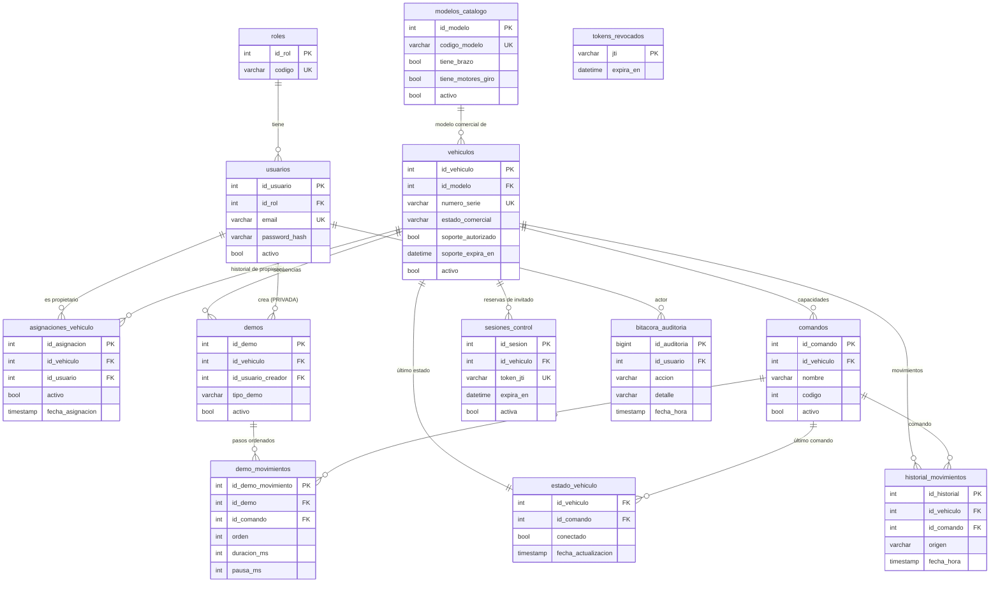

# API Vehículo IoT - Documentación Técnica

Este repositorio contiene el backend (API REST y WebSockets) desarrollado con **FastAPI** y desplegado en **AWS EC2** para el control y telemetría de una Excavadora IoT.

## 1. Mapeo de Endpoints y Procedimientos Almacenados (RDS)
La API delega toda la lógica de negocio y persistencia a una base de datos MySQL en Amazon RDS. A continuación, se detalla la relación entre los endpoints de la API y los Procedimientos Almacenados (SPs) ejecutados:

### Módulo de Secuencias DEMO y Control (`/api/demos`)

| Endpoint | Método | Procedimiento Almacenado (SP) | Descripción |
| :--- | :--- | :--- | :--- |
| `/vehiculo/{id_vehiculo}` | `GET` | `sp_obtener_demos` | Lista todas las secuencias DEMO asociadas a un vehículo. |
| `/` | `POST` | `sp_crear_demo` | Registra una nueva secuencia DEMO. |
| `/{id_demo}` | `PUT` | `sp_actualizar_demo` | Actualiza la información general de una DEMO. |
| `/{id_demo}` | `DELETE` | `sp_eliminar_demo` | Elimina una secuencia DEMO. |
| `/{id_demo}/movimientos` | `POST` | `sp_agregar_movimiento` | Agrega un nuevo paso (comando) a una DEMO existente. |
| `/{id_demo}/movimientos` | `GET` | `sp_obtener_movimientos` | Obtiene la lista ordenada de pasos de una DEMO. |
| `/movimientos/{id_mov}` | `PUT` | `sp_actualizar_movimiento` | Modifica la duración, pausa o comando de un paso. |
| `/movimientos/{id_mov}` | `DELETE` | `sp_eliminar_movimiento` | Elimina un paso específico de la secuencia. |
| `/{id_demo}/ejecutar` | `POST` | `sp_actualizar_estado` | Ejecuta la DEMO de forma asíncrona. Actualiza el estado del vehículo en RDS en cada iteración. |
| `/vehiculo/{id}/cancelar` | `POST` | `sp_actualizar_estado` | Cancela la ejecución asíncrona de emergencia y restablece el vehículo a estado Standby (comando 9). |

*(Nota para la evaluación: Todos los endpoints cuentan con validación de datos mediante Pydantic y manejo de excepciones HTTP para proteger la base de datos).*

---

## 2. Eventos y Mensajería en Tiempo Real (WebSockets)

La API proporciona comunicación bidireccional en tiempo real (WSS) para monitorear la ejecución de las secuencias DEMO y el estado del vehículo. 

* **URL de Conexión:** `wss://api-vehiculo-iot.duckdns.org/api/demos/ws/{id_vehiculo}`

El servidor emite los siguientes payloads en formato **JSON** dependiendo de la etapa de la demostración:

### A. Al conectar (`estado_inicial`)
Se dispara automáticamente en el momento que un cliente se suscribe al WebSocket. Consulta la base de datos y devuelve el último estado conocido del vehículo.

```json
{
  "tipo_evento": "estado_inicial",
  "vehiculo": 1,
  "datos": {
    "id_vehiculo": 1,
    "vehiculo": "Excavadora IoT",
    "id_comando": 2,
    "comando": "RETROCEDER",
    "codigo": 2,
    "conectado": 1,
    "fecha_actualizacion": "2026-10-18T04:06:40"
  }
}

```

### B. Al iniciar una secuencia (`inicio_demo`)

Se emite cuando se recibe una petición `POST` válida en el endpoint de ejecución.

```json
{
  "tipo_evento": "inicio_demo",
  "vehiculo": 1
}

```

### C. Durante la ejecución (`movimiento_demo`)

Se emite iterativamente por cada paso configurado en la secuencia de la base de datos, notificando qué comando exacto se está ejecutando en ese instante.

```json
{
  "tipo_evento": "movimiento_demo",
  "vehiculo": 1,
  "comando_en_ejecucion": 3,
  "accion": "ejecutando_paso",
  "orden": 2
}

```

### D. Freno de Emergencia (`cancelacion_demo`)

Se emite si un usuario hace un llamado al endpoint `/cancelar`. Interrumpe los movimientos inmediatamente y restablece el hardware.

```json
{
  "tipo_evento": "cancelacion_demo",
  "vehiculo": 1
}

```

### E. Finalización exitosa (`fin_demo`)

Se emite cuando la secuencia termina todos sus pasos de manera natural.

```json
{
  "tipo_evento": "fin_demo",
  "vehiculo": 1
}

```


---

## 3. Administración 4.3 · Roles, seguridad y reglas de negocio

### 3.1 Quién puede hacer qué (lo valida el **servidor** en cada petición)

| Acción | Sin sesión | Invitado (3 min) | Usuario comprador | Administrador |
| :--- | :---: | :---: | :---: | :---: |
| Catálogo público (`/api/exhibicion/catalogo`) | ✅ | ✅ | ✅ | ✅ |
| Leer estado / historial / demos de una unidad | Sólo EXHIBICIÓN | Sólo EXHIBICIÓN | Sólo **sus** unidades | Todas |
| Enviar comandos / ejecutar demos | ❌ 401 | Sólo su unidad reservada y comandos básicos¹ | Sólo **sus** unidades | Todas, excepto VENDIDAS sin soporte² |
| Crear / editar / borrar demos y pasos | ❌ 401 | ❌ 403 | Sólo **sus** demos PRIVADAS | Demos de EMPRESA (no las privadas) |
| Inventario, modelos, clientes, asignaciones, auditoría | ❌ 401 | ❌ 403 | ❌ 403 | ✅ |

¹ Invitado: `AVANZAR, RETROCEDER, GIRAR_IZQUIERDA, GIRAR_DERECHA, LUZ, SONIDO, DETENER`. Reserva **exclusiva** (una segunda sesión sobre la misma unidad recibe `409`). Al vencer, un vigilante en el servidor cierra la sesión y **envía DETENER** aunque el visitante haya cerrado la página.
² El comprador concede soporte temporal desde *Mis vehículos* (`PATCH /api/mis-vehiculos/{id}/soporte`).

Otras reglas:
- **Sesión:** JWT HS256 (8 h Admin/Usuario, 3 min Invitado). `POST /api/auth/logout` **invalida** el token (`tokens_revocados`); una cuenta desactivada pierde el acceso de inmediato.
- **Límite de intentos:** 5 contraseñas incorrectas por correo+IP en 5 min → `429` durante 5 min. Cada fallo queda en la bitácora (`LOGIN_FALLIDO`).
- **Baja lógica:** `DELETE /api/vehiculos/{id}` marca `activo = 0` y estado `INACTIVO`; nunca borra la fila. Modelos y clientes se desactivan con `PUT` (`activo = false`). Una unidad con comprador no se puede dar de baja ni cambiar de estado hasta revocar la asignación.
- **Asignaciones:** reasignar desactiva la asignación anterior (`activo = 0`, queda como historial) y revoca los permisos del titular anterior.
- **Demos:** cada paso valida duración 100–10 000 ms, pausa 0–5 000 ms y que el comando pertenezca a la misma unidad y esté habilitado. `DETENER` cancela cualquier demo en curso.
- **Auditoría:** `bitacora_auditoria` registra login/logout, intentos fallidos, altas, ediciones, bajas, asignaciones, revocaciones, soporte, reservas, expiraciones de invitado, cambios de demos y **todos los accesos bloqueados** (BOLA, sin soporte, sin sesión, comando restringido).

### 3.2 Endpoints de Administración agregados

| Endpoint | Método | Rol | Descripción |
| :--- | :--- | :--- | :--- |
| `/api/auth/login` · `/logout` · `/me` · `/invitado` | POST/GET | — | Sesión JWT y prueba temporal de Invitado |
| `/api/admin/dashboard` | GET | ADMIN | Métricas reales, inventario, modelos, clientes, sesiones y bitácora |
| `/api/admin/modelos` · `/modelos/{id}` | GET/POST/PUT | ADMIN | Catálogo comercial (editar o desactivar con `PUT`) |
| `/api/admin/unidades` · `/unidades/{id}` | POST/PUT | ADMIN | Alta y edición de unidades físicas |
| `/api/vehiculos/{id}` | DELETE | ADMIN | Baja lógica de una unidad |
| `/api/admin/clientes` · `/clientes/{id}` | GET/POST/PUT | ADMIN | Compradores (editar, desactivar, restablecer contraseña) |
| `/api/admin/asignaciones` · `/asignaciones/{id}` | POST/DELETE | ADMIN | Asignar / revocar propiedad |
| `/api/admin/auditoria` | GET | ADMIN | Bitácora |
| `/api/mis-vehiculos` · `/mis-vehiculos/{id}/soporte` | GET/PATCH | USUARIO | Unidades propias y consentimiento de soporte |
| `/api/exhibicion/catalogo` | GET | Público | Modelos y unidades de exhibición libres/ocupadas |

---

## 4. Modelo de datos (diagrama entidad-relación)

Tablas de 4.1/4.2 (conservadas) y de 4.3 (agregadas por las migraciones `V001` y `V002`).



> Las columnas de las tablas 4.1/4.2 se documentan según el uso que hace la API. Confírmalas en RDS con `SHOW CREATE TABLE <tabla>;` antes de entregar.

---

## 5. Respaldo y migraciones (procedimiento seguro)

**DDL en MySQL hace COMMIT implícito: `ROLLBACK` no deshace un `CREATE`/`ALTER`.** Por eso cada migración tiene su script de reversión y se respalda antes.

1. **Inventario previo:** `migrations/00_precheck_and_counts.sql` (conteo de filas por tabla).
2. **Respaldo** (desde EC2, guarda el archivo fuera del repositorio):
   ```bash
   mysqldump -h <endpoint-rds> -u <usuario> -p --single-transaction --routines --triggers \
             vehiculo_iot > ~/respaldos/respaldo_$(date +%Y%m%d_%H%M).sql
   ```
3. **Aplicar** en este orden (primero en una base de prueba restaurada del respaldo):
   - `V001__4_3_administracion_up.sql` — roles, usuarios, modelos, asignaciones, sesiones, auditoría y columnas aditivas.
   - `V002__seguridad_sesiones_up.sql` — tabla `tokens_revocados` y estado `INACTIVO` (baja lógica).
4. **Verificación posterior:** `migrations/02_postcheck_validation.sql` (los conteos de `vehiculos`, `comandos`, `historial_movimientos`, `demos` y `demo_movimientos` deben coincidir con el paso 1).
5. **Reversión** (sólo prueba): `V002__..._down.sql` y luego `V001__..._down.sql`; o restaurar el respaldo con `mysql ... vehiculo_iot < respaldo.sql`.

El servidor también aplica de forma **idempotente y no destructiva** los cambios de V001/V002 al arrancar (`database.ensure_schema_4_3`): sólo crea lo que falta, nunca borra datos ni reasigna unidades.

---

## 6. Configuración y secretos

Copia `.env.example` a `.env` **sólo en el servidor** (`.env` está en `.gitignore`):

| Variable | Obligatoria | Descripción |
| :--- | :---: | :--- |
| `DB_HOST`, `DB_PORT`, `DB_USER`, `DB_PASSWORD`, `DB_NAME` | ✅ | Conexión a Amazon RDS |
| `JWT_SECRET` | ✅ | Clave de firma de sesiones (≥ 32 caracteres). Genérala con `python3 -c "import secrets; print(secrets.token_urlsafe(48))"` |
| `SEED_ADMIN_PASSWORD`, `SEED_CYNTHIA_PASSWORD`, `SEED_CARLOS_PASSWORD`, `SEED_INVITADO_PASSWORD` | Opcional | Contraseñas de las cuentas de demostración. Si se definen, se **rotan** al reiniciar; si no, nunca se sobrescriben. |

Las contraseñas de ejemplo que aparecen en `V001` quedaron **obsoletas**: rótalas con las variables `SEED_*` y reinicia la API.

---

## 7. Matriz de pruebas (P01–P17)

Ejecutar sobre la plataforma publicada con las cuentas de cada rol. La columna *Resultado* la llena cada evaluador.

| # | Prueba | Rol | Pasos | Esperado | Resultado |
| :-- | :-- | :-- | :-- | :-- | :-- |
| P01 | Login Admin | ADMIN | Administración → correo y contraseña | 200, panel de Admin con datos de RDS | |
| P02 | Alta de unidad | ADMIN | Registrar unidad con serie nueva | 201; serie repetida → 409 | |
| P03 | Alta de cliente | ADMIN | Registrar cliente (contraseña ≥ 8) | 201; correo repetido → 409 | |
| P04 | Asignación | ADMIN | Asignar unidad a cliente | 201, unidad VENDIDO, auditoría ASIGNACION_UNIDAD | |
| P05 | Aislamiento de comprador | USUARIO | Iniciar sesión como Cynthia | Sólo ve sus unidades y demos | |
| P06 | Control | USUARIO | Mover su unidad | 200 y movimiento físico/3D | |
| P07 | WSS | Todos | Mover y observar Monitoreo en otra pestaña | Evento en tiempo real | |
| P08 | Historial 10 | USUARIO | Monitoreo tras 12 movimientos | Últimos 10 en orden | |
| P09 | Demo persistente | USUARIO | Crear demo y pasos, recargar | Persisten en RDS (PRIVADA) | |
| P10 | Ejecución / cancelación | USUARIO | Iniciar demo y DETENER | Se detiene de inmediato | |
| P11 | Invitado | — | Probar como Invitado | 201, 3 min, comandos básicos | |
| P12 | Rechazo Admin → Invitado | INVITADO | Entrar a Administración / unidad privada | 403 | |
| P13 | Rechazo vehículo ajeno | USUARIO | Prueba "Usuario → unidad ajena" o Postman con id ajeno | 403 y auditoría ACCESO_CRUZADO_BLOQUEADO | |
| P14 | Exclusividad | INVITADO ×2 | Segunda prueba sobre la misma unidad | 409 | |
| P15 | Reconexión | Todos | Cortar Wi-Fi y reconectar | WSS se reconecta y reconcilia por REST | |
| P16 | Responsive | Todos | Celular vertical/horizontal | Todo usable sin desplazamiento horizontal | |
| P17 | Auditoría | ADMIN | Revisar bitácora | Eventos de todas las pruebas anteriores | |

**Pruebas automáticas:** `tests/test_seguridad.py` ejecuta 61 verificaciones de estas reglas contra una base MySQL **local de prueba** (nunca contra RDS de producción). Ver `tests/README.md`.
